# Pipeline de Desempeño de Negocio — Nexova (diseño · Hito 6, parte 1/3)

> Documento de diseño. El código de orquestación llega en la parte 2 (`data/pipelines/pipeline.py`).
> BRIEFING: [`docs/CONTEXT-data-pipelines-nexova.md`](../../docs/CONTEXT-data-pipelines-nexova.md)
> (pipeline de desempeño) y [`docs/CONTEXT-telemetry-nexova.md`](../../docs/CONTEXT-telemetry-nexova.md)
> (métricas obligatorias de telemetría).

## Propósito (en una frase)

Producir cada lunes por la mañana el **"Reporte Semanal de Desempeño por Oficina y Programa"**
que leen Laura (CEO) y Elena (L&D): una fila por oficina, programa y semana ISO en
`reporting.weekly_office_program_performance` con los cuatro KPIs del BRIEFING — **costo de
material por oficina/programa**, **kits entregados**, **frecuencia de escasez** y **frecuencia de
variación de costo** — calculados a partir de las métricas obligatorias de telemetría
`inbound_order_created`, `outbound_order_created`, `stock_threshold_triggered` y
`kit_cost_variance_detected`.

---

## 1. Estado actual

### 1.1 Lo que ya existe

| Pieza | Dónde | Qué hace |
| --- | --- | --- |
| Captura | `uis/backoffice/lib/telemetry.ts` (`track()`) | El backoffice emite los eventos del plan (`docs/telemetry/telemetry-plan.md`) en lotes cada 10 s / 20 eventos, con `sendBeacon` al cerrar. Los de inventario solo tras el 201 de la API, con `stock_after`, `min_stock` y `cost_baseline` de la respuesta. |
| Almacenamiento | `public.telemetry_events` en Supabase (`POST /telemetry/events`) | Solo inserción, una fila por evento validado contra `event-schemas.json`, idempotente por `eventId`. Columnas `timestamp`, `service`, `event_type`, `level`, `value`, `message`, `tags` (JSONB). |
| Reporte técnico | `services/api/app/telemetry/analysis.py` + `GET /telemetry/report` | Para ingeniería: volumen por día y tipo, tasa de errores/avisos, LCP, fallos de login, peticiones sin respuesta y errores de JS. |

Los cuatro eventos que necesita este pipeline ya se capturan con las dimensiones del BRIEFING
en `tags`:

| `event_type` | Claves de `tags` que usa el pipeline |
| --- | --- |
| `inbound_order_created` | `office`, `programme_id`, `currency`, `total_cost` (= `quantity × unit_cost`), `order_id` |
| `outbound_order_created` | `office`, `programme_id`, `quantity`, `order_id` |
| `stock_threshold_triggered` | `office`, `programme_id`, `product_id`, `trigger_order_id` |
| `kit_cost_variance_detected` | `office`, `programme_id`, `supplier_id`, `variance_pct` |
| (todos) | `_envelope.event_id`, `_envelope.environment` |

El campo de coste que pide el BRIEFING (§3, "chequeo rápido de esquema") **ya existe**:
`unit_cost` y `total_cost` en `inbound_order_created` desde el proyecto de captura.

### 1.2 La brecha

El reporte técnico responde "¿qué tan sano está el sistema?". Nadie responde hoy, de forma
confiable y sin armar un PDF a mano, **"¿cuánto invirtió cada oficina en material de cada
programa esta semana, cuánto llegó realmente a las personas, y dónde nos quedamos sin
material o nos subieron el precio?"**. Ese consolidado semanal por oficina y programa es el
entregable de este pipeline. El reporte técnico **no se toca**: ni `analysis.py` ni
`GET /telemetry/report` cambian, y `telemetry_events` solo se lee.

---

## 2. Extracción

| | |
| --- | --- |
| **Fuente** | `public.telemetry_events` (solo lectura). No hace falta ninguna otra tabla de dominio: las dimensiones del BRIEFING ya viajan en `tags`. |
| **Filtro en SQL** | `event_type IN ('inbound_order_created', 'outbound_order_created', 'stock_threshold_triggered', 'kit_cost_variance_detected')` **y** `timestamp >= :window_start AND timestamp < :window_end` (UTC, fin exclusivo) **y** `tags->'_envelope'->>'environment' = :environment` (no mezclar pruebas con producción). |
| **Columnas** | `timestamp`, `event_type`, `tags` (nunca `SELECT *` de toda la tabla). |
| **Forma del dato** | Filas con `tags` JSONB → DataFrame de Pandas; `pd.json_normalize` extrae `office`, `programme_id`, `currency`, `total_cost`, `quantity` y `_envelope.event_id`. |
| **Cadencia de la fuente** | Continua: los eventos llegan en lotes cada ~10 s mientras haya actividad en el backoffice. |
| **Cadencia del pipeline** | Semanal: **lunes 06:00 Europe/Madrid**. Recalcula la semana ISO anterior y, como margen para eventos tardíos, la semana previa a esa (ventana de 2 semanas). También se puede lanzar a mano o en modo backfill para un rango de semanas. |

---

## 3. Flujo de datos

```mermaid
flowchart LR
    TE[("public.telemetry_events<br/>solo lectura")]
    TE -->|"EXTRACCIÓN<br/>extract_material_events<br/>4 event_type · ventana [inicio, fin) · environment"| RAWDF["DataFrame de eventos<br/>timestamp, event_type, tags"]

    RAWDF -->|"TRANSFORMACIÓN<br/>compute_weekly_office_program_kpis"| T1["1 · extraer office, programme_id,<br/>currency, total_cost de tags"]
    T1 --> T2["2 · validar: descartar filas sin<br/>office/programme_id, deduplicar por event_id"]
    T2 --> T3["3 · timestamp → datetime UTC<br/>week_start = lunes ISO"]
    T3 --> T4["4 · groupby office × programme_id × week_start<br/>sum(total_cost) · count por event_type"]

    T4 -->|"CARGA<br/>load_weekly_office_program_performance<br/>upsert por (office, programme_id, week_start)"| OUT[("reporting.weekly_office_program_performance")]

    RUNS[("reporting.pipeline_runs")]
    RAWDF -. "run_id, ventana, filas extraídas" .-> RUNS
    OUT -. "filas cargadas, estado final" .-> RUNS

    OUT --> API["services: GET /reporting/weekly-office-program-performance"]
    API --> UI["Backoffice /reporting<br/>(Laura y Elena)"]
```



Las tres etapas son independientes: la extracción no sabe de KPIs, la transformación es Pandas
puro (sin base de datos: se puede probar con datos en memoria) y la carga no recalcula nada.

### 3.1 Cálculo de cada columna (grano: `office` × `programme_id` × `week_start`)

| Columna | KPI del BRIEFING | Cálculo |
| --- | --- | --- |
| `total_material_cost` | Costo de material por oficina/programa | `sum(tags.total_cost)` de `inbound_order_created` de la semana, en la moneda de la oficina |
| `kits_delivered_count` | Kits entregados | `count(outbound_order_created)` de la semana (órdenes de salida, como define el BRIEFING) |
| `shortage_events_count` | Frecuencia de escasez | `count(stock_threshold_triggered)` de la semana |
| `cost_variance_events_count` | Frecuencia de variación de costo | `count(kit_cost_variance_detected)` de la semana |
| `currency` | — | `EUR` si `office = valencia`, `USD` si `miami`. **Nunca se convierte ni se suma entre monedas.** |
| `week_start` | — | Lunes de la semana ISO del `timestamp` del evento, en UTC |
| `computed_at` | — | Momento de la carga |

Combinaciones oficina/programa sin ningún evento en la semana no generan fila (no hay nada que
reportar); el dashboard lo muestra como "sin actividad".

---

## 4. Fuente insert-only, destino que se actualiza

`telemetry_events` **nunca actualiza filas**: cada hecho es un evento nuevo (una entrega es un
`outbound_order_created`; no se "edita" una orden). Lo que sí se actualiza es el **destino**:
la fila de una semana se vuelve a calcular cuando llegan eventos tardíos o cuando la semana
aún está en curso en una ejecución manual.

Estrategia concreta para no duplicar:

1. **En el origen:** `telemetry_events` ya es idempotente por `eventId` (el receptor no inserta
   un `eventId` repetido). Aun así, la transformación hace `drop_duplicates` sobre
   `_envelope.event_id` antes de agregar, por si algún día se cargan eventos por otra vía.
2. **En el destino:** cada ejecución **recalcula semanas completas desde los eventos** (nunca
   "suma lo nuevo a lo que había") y escribe con
   `INSERT … ON CONFLICT (office, programme_id, week_start) DO UPDATE SET <KPIs>, computed_at`,
   apoyándose en el `unique (office, programme_id, week_start)` del BRIEFING. Volver a calcular
   una semana sustituye su fila; no añade otra.

---

## 5. Tablas y endpoints nuevos (separados de la telemetría técnica)

**Esquema `reporting`** (nuevo, en Supabase):

- `reporting.weekly_office_program_performance` — exactamente la tabla del BRIEFING §5.
- `reporting.pipeline_runs` — log de ejecución (§7).

**Endpoints nuevos** en el módulo de reporting de la API (`services/api/app/reporting/` +
`app/routers/reporting.py`; equivale al `services/reporting/` del enunciado, igual que la API
vive en `services/api/app/`). Mismo esquema de autenticación que el resto (Bearer). Ninguna
lógica de ETL vive en `services/`: importan de `data/pipelines/`.

| Endpoint | Para qué | Llama a (en `data/pipelines/`) |
| --- | --- | --- |
| `GET /reporting/weekly-office-program-performance?week_start=YYYY-MM-DD` | **Consulta de KPIs** (lo consume el dashboard). Sin `week_start`: la semana calculada más reciente. Respuesta con el contrato del BRIEFING §6 | `pipelines.queries.get_weekly_performance(engine, week_start)` |
| `GET /reporting/pipeline-runs/latest` | **Estado** y metadata de la última ejecución | `pipelines.queries.get_latest_run(engine)` |
| `POST /reporting/pipeline-runs` | **Disparo manual**. Responde `202` con el `run_id` y la ejecución sigue en segundo plano; `409` si ya hay una en curso | `pipelines.pipeline.weekly_office_program_performance(trigger="manual")` |

`data/` se instala en el entorno de la API como dependencia de ruta (igual que
`packages/shared/incidents_core`), así `services` importa `pipelines.*` sin copiar código. La
dirección de dependencia es siempre `services → data/pipelines`, nunca al revés: el pipeline no
importa nada de `app`.

---

## 6. Idempotencia y recuperación

**Qué pasa en la segunda ejecución después de un fallo en la carga:**

1. La carga de todas las filas de la ventana ocurre en **una sola transacción**. Si Supabase
   cae a mitad (p. ej. timeout tras escribir 847 de 1.412 filas), la base de datos deshace
   todo: no queda ninguna fila a medias. `pipeline_runs` registra la ejecución como `failed`,
   con la fase (`load`) y el error.
2. La siguiente ejecución (reintento automático de la task, o la próxima programada/manual)
   **vuelve a calcular la ventana completa desde `telemetry_events`** y hace el mismo `upsert`.
   Como los eventos de origen son inmutables y el cálculo es determinista, el resultado es
   idéntico al de una ejecución limpia.
3. Aunque una carga anterior sí se hubiera confirmado, repetirla deja la tabla igual: el
   `upsert` por `(office, programme_id, week_start)` sustituye cada fila por el mismo valor.

**Eventos tardíos.** Cada ejecución recalcula las **dos últimas semanas** completas: un evento
de una semana ya publicada (p. ej. un lote enviado tarde por `sendBeacon`) actualiza esa fila en
la siguiente ejecución, con nuevo `computed_at`, y `pipeline_runs` deja constancia de qué
ejecución la recalculó. Para retrasos mayores hay modo **backfill** (`--from-week` /
`--to-week`).

**Ejecuciones concurrentes.** Antes de cargar, la ejecución toma un `pg_advisory_xact_lock`
propio del pipeline: si el cron de las 06:00 y un "Ejecutar ahora" del backoffice coinciden, la
segunda espera a que termine la primera (y recalcula lo mismo: el resultado no cambia). El
endpoint de disparo manual además responde `409` si `pipeline_runs` tiene una ejecución en
`running`.

---

## 7. Log de ejecución: `reporting.pipeline_runs`

| Campo | Tipo | Por qué hace falta para auditar |
| --- | --- | --- |
| `run_id` | `uuid` PK | Identifica la ejecución; enlaza logs de Prefect, filas recalculadas y alertas |
| `flow_run_id` | `text` | Id de la ejecución en Prefect: abre su traza y sus reintentos en la UI de Prefect |
| `trigger` | `text` (`scheduled` / `manual` / `backfill`) | Distingue la ejecución del lunes de las lanzadas a mano |
| `status` | `text` (`running` / `completed` / `failed`) | Estado que consultan el endpoint, la alerta y el bloqueo de concurrencia |
| `started_at` | `timestamptz` | Cuándo empezó: detecta ejecuciones que no llegan (el lunes sin ejecución) |
| `finished_at` | `timestamptz` null | Cuándo terminó; si sigue nulo mucho tiempo, la ejecución se colgó |
| `window_start` / `window_end` | `date` | Qué semanas cubrió: explica qué filas pudo cambiar |
| `environment` | `text` | Si leyó eventos de `production` o de `development` |
| `events_extracted` | `integer` | Volumen leído: comparado con semanas anteriores distingue "semana tranquila" de "captura caída" |
| `events_discarded` | `integer` | Eventos sin `office`/`programme_id` o duplicados: si sube, algo cambió en la captura |
| `rows_upserted` | `integer` | Filas escritas en el destino |
| `failed_phase` | `text` null (`extract` / `transform` / `load`) | Dónde se rompió: dice desde dónde reintentar |
| `error_message` | `text` null | Primer error (sin datos personales) |

**Silencio vs. ausencia.** Si una semana tiene `events_extracted = 0` pero la semana anterior
tuvo actividad, la ejecución se completa (cero es un valor válido) pero se marca con un aviso:
puede ser una semana sin actividad o una captura caída. Para distinguirlo se mira
`GET /telemetry/report` (si hubo `page_viewed` ese período, la captura funcionaba).

---

## 8. Mapeo a Prefect

**Flow principal:** `weekly_office_program_performance(trigger, from_week, to_week, environment)`
— resuelve la ventana, abre la fila de `pipeline_runs` y encadena las tasks.

| Task | Etapa | Entrada → salida | Resiliencia |
| --- | --- | --- | --- |
| `extract_material_events` | Extracción | ventana, `environment` → DataFrame de eventos | `retries=3`, `retry_delay_seconds=[10, 30, 60]` (fallos de red con Supabase) |
| `compute_weekly_office_program_kpis` | Transformación | DataFrame de eventos → DataFrame de KPIs | Caché (`cache_key_fn` = hash de los `event_id` de la entrada, `cache_expiration` 1 h): un reintento de la carga no recalcula |
| `load_weekly_office_program_performance` | Carga | DataFrame de KPIs → nº de filas | `retries=2` (la transacción es atómica, reintentar es seguro) |
| `record_pipeline_run` | Log | métricas de la ejecución → fila en `pipeline_runs` | `retries=2` |
| `export_weekly_snapshot` (opcional) | Copia CSV del resultado en `data/eval/` | KPIs → ruta del archivo | Se invoca con `return_state=True`: si falla, la ejecución sigue |

**States relevantes:** `Running` (abre `pipeline_runs`), `Completed` (cierra con
`status=completed`), `Failed` (cierra con `status=failed`, `failed_phase` y `error_message`;
el estado de la task opcional fallida no cambia el del flow), `Retrying` (reintentos de las
tasks con red).

**Segundo flow (opcional):** `backfill_weekly_office_program_performance(from_week, to_week)`,
que llama al principal semana a semana.

**Parte 3:** las tres etapas pasan a ser **subflows** (`extract_weekly_material_activity`,
`transform_weekly_office_program_kpis`, `load_weekly_office_program_performance_subflow`), con
tests unitarios de la transformación en `tests/pipelines/test_pipeline.py`.

**Prefect blocks:**

| Block | Contenido |
| --- | --- |
| `Secret` `nexova-supabase-database-url` | Cadena de conexión a Supabase (la misma `DATABASE_URL` de `services/api/.env`). En local, si el block no existe, se lee la variable de entorno. |
| `String` `nexova-pipeline-environment` | `production` o `development`: qué eventos lee el pipeline |

**Ejecución:**

```bash
# desde la raíz del monorepo (parte 2)
python data/pipelines/pipeline.py                         # ventana por defecto: 2 últimas semanas
python data/pipelines/pipeline.py --from-week 2026-11-02 --to-week 2026-11-16   # backfill
```

Programación: un deployment de Prefect con cron `0 6 * * 1` en `Europe/Madrid`.

---

## 9. Implementación (parte 2/3)

| Pieza | Archivo |
| --- | --- |
| Flow y tasks de Prefect, CLI | `data/pipelines/pipeline.py` |
| Transformaciones (Pandas puro) | `data/process/weekly_performance.py` |
| Tablas `reporting` y conexión | `data/pipelines/db.py` |
| Lecturas para la API | `data/pipelines/queries.py` |
| Endpoints | `services/api/app/routers/reporting.py` (importa `pipelines.*`) |
| Tests del flow (SQLite + `prefect_test_harness`) | `tests/pipelines/test_pipeline_flow.py` |

`data/` es un paquete instalable (`data/pyproject.toml`, nombre `nexova-data`) que
`services/api` instala como dependencia de ruta, así que el mismo entorno sirve para la API, el
CLI y los tests.

**Comandos** (desde la raíz del monorepo; en PowerShell igual):

```bash
# ventana por defecto: 2 semanas cerradas + la semana en curso (ejecución manual)
uv run --project services/api python data/pipelines/pipeline.py
# backfill de un rango de semanas (lunes, ambos incluidos)
uv run --project services/api python data/pipelines/pipeline.py --from-week 2026-11-02 --to-week 2026-11-16
# leer eventos de producción en vez de desarrollo
uv run --project services/api python data/pipelines/pipeline.py --environment production
# tests del flow
uv run --project services/api python -m pytest tests/pipelines
```

- **Conexión:** Prefect Secret block `nexova-supabase-database-url`; si no existe, `DATABASE_URL`
  del entorno o de `services/api/.env`. El primer `run` crea el esquema `reporting` y sus tablas.
- **Entorno de los eventos:** `--environment`, variable `PIPELINE_ENVIRONMENT` o block
  `nexova-pipeline-environment`; por defecto `development` (es lo que emite el backoffice en
  local con `npm run dev`).
- **Frecuencia prevista:** semanal, lunes 06:00 Europe/Madrid. Con un servidor de Prefect:
  `prefect deploy` del flow `weekly_office_program_performance` con cron `0 6 * * 1` y zona
  `Europe/Madrid` (la ejecución programada usa `trigger="scheduled"`: las 2 semanas cerradas).
- Sin servidor de Prefect configurado, cada ejecución levanta uno temporal (unos segundos). El
  aviso `Failed to send telemetry: 403` de Prefect es su propia analítica de uso y no afecta;
  se quita con `PREFECT_SERVER_ANALYTICS_ENABLED=false`.

**Verificado** en SQLite y en PostgreSQL 16: dos ejecuciones seguidas dejan las mismas filas
(upsert por la clave única), un evento tardío actualiza la semana publicada, un fallo en la carga
queda en `pipeline_runs` como `failed` con `failed_phase = load` sin escribir filas, y si falla la
copia CSV opcional la ejecución se completa igual.

---

## 10. Respuestas a las preguntas de diseño

| Pregunta | Respuesta en este diseño |
| --- | --- |
| 1. Duplicados en el origen | `eventId` es la clave: el receptor no lo inserta dos veces (§5.3 del plan de telemetría) y la transformación hace `drop_duplicates` por `_envelope.event_id` |
| 2. Reintento tras fallo en la carga | Transacción única + recálculo completo de la ventana + `upsert` por la clave única del BRIEFING (§6) |
| 3. Eventos tardíos | Ventana de 2 semanas en cada ejecución y backfill; `computed_at` y `pipeline_runs` dejan el rastro |
| 4. Silencio vs. ausencia | `events_extracted` por ejecución, aviso si cae a 0 tras una semana con actividad, y alerta si el lunes no hay ejecución en `pipeline_runs` |
| 5. Trazabilidad | `run_id` ↔ `flow_run_id` de Prefect; cada evento conserva `requestId` y `eventId` en `tags._envelope` |
| 6. Crecimiento vs. pérdida | Comparar `events_extracted` con el volumen de `page_viewed` del reporte técnico del mismo período |
| 7. Caída de la base de datos | `failed_phase` en `pipeline_runs`; la extracción y la transformación no escriben nada, así que se reintenta desde la extracción sin riesgo |
| 8. Buffer offline en el navegador | No en v1: la cola en memoria + `sendBeacon` cubre cierres de pestaña; un buffer en `localStorage` sería posible porque el servidor ya deduplica por `eventId` |
| 9. Reintentos de `POST /telemetry/events` | Ya resuelto: el receptor devuelve 200 y cuenta como guardado un `eventId` que ya existe |
| 10. Ejecuciones concurrentes | Advisory lock del pipeline + `409` en el disparo manual si hay una en `running` |
