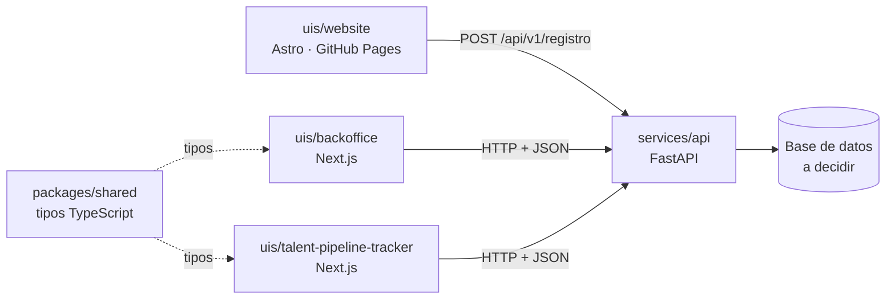

# Propuesta de Arquitectura de Backend — Nexova Solutions

> **Estado:** borrador v1 para revisión del CTO (Sergio Molina)
> **Autora:** Carolina Kaechele — equipo de AI Engineering
> **Ubicación prevista del código:** `services/api/` dentro del monorepo `company-project-ai-engineering`
> **Alcance:** cómo estructurar el backend antes de escribir código. No incluye implementación.

---

## 1. Resumen ejecutivo

Propongo un **monolito modular en FastAPI con arquitectura en capas, organizado por dominios de negocio**: una sola aplicación (`services/api/`), dividida en módulos por dominio (`candidatos`, `clientes`, `procesos`, `candidaturas`…), y dentro de cada módulo tres capas con responsabilidades separadas: **router → service → repository**.

En una frase: *una sola API para toda la empresa, que crece por dominios sin mezclar HTTP, reglas de negocio y acceso a datos.*

---

## 2. Qué sabemos de Nexova que condiciona la arquitectura

La elección no parte de una preferencia técnica, sino de estos rasgos de la empresa (fuente: `CONTEXT.md`, briefing general de Nexova):

| Rasgo de Nexova | Consecuencia para el backend |
| --- | --- |
| **Varios departamentos con datos muy distintos** (Selección, Formación, Soporte, Ventas, RRHH interno, Dirección) | El sistema tiene que crecer por **dominios** sin que uno contamine a otro. |
| **El negocio principal es Selección** (40 consultores, procesos manuales, clientes que llaman para preguntar el estado) | El primer dominio a construir es el pipeline candidato → proceso → candidatura, ya modelado en los Hitos 2 y 3. |
| **La IA es el núcleo, no un extra** (scoring de CVs, RAG sobre candidatos, agentes) | La lógica de negocio debe vivir **fuera de los endpoints**, para que la reutilicen la API, los agentes y los workers sin duplicarla. |
| **Equipo de Tecnología de 6 personas** y un stack actual de herramientas desconectadas | Hay que **reducir** piezas sueltas, no multiplicarlas: nada de microservicios al inicio. |
| **Datos personales de candidatos** (email, teléfono, LinkedIn) en España (UE) y EE. UU. | Separar claramente lo público de lo interno y tratar la protección de datos como requisito de diseño. |
| **Varios frontends ya existentes**: web pública (Astro, GitHub Pages), backoffice y Talent Pipeline Tracker (Next.js) | Frontend y backend son **sistemas separados** que hablan por HTTP → hay que resolver CORS, contratos y variables de entorno. |

---

## 3. Patrón arquitectónico propuesto

### 3.1 La propuesta: arquitectura en capas + módulos por dominio

```
Petición HTTP
     │
     ▼
┌──────────────┐  Recibe la petición, valida la entrada con Pydantic,
│   router     │  llama al service y devuelve la respuesta. No contiene reglas de negocio.
└──────┬───────┘
       ▼
┌──────────────┐  Reglas de negocio de Nexova: "una candidatura no puede
│   service    │  avanzar de etapa si el proceso está cerrado", "un candidato
└──────┬───────┘  no se registra dos veces con el mismo email".
       ▼
┌──────────────┐  Único sitio que sabe cómo se guardan y leen los datos.
│  repository  │  Si mañana cambia el motor de base de datos, solo cambia esta capa.
└──────────────┘
```

Cada **dominio** tiene sus propias tres capas. Las capas están **dentro** del dominio, no al revés.

### 3.2 Por qué encaja con Nexova

1. **La IA necesita la lógica fuera del endpoint.** El futuro scoring de CVs o el agente de comunicación con candidatos tendrán que usar las mismas reglas que la API ("¿en qué etapa está esta candidatura?"). Si esas reglas viven en el `service`, el agente las llama directamente; si vivieran dentro del router, habría que duplicarlas.
2. **Cinco equipos, cinco dominios.** Agrupar por dominio hace que el código de Formación no tenga que tocar el de Selección. Cuando llegue un dominio nuevo, se añade una carpeta y un router, sin reorganizar lo que ya existe.
3. **Coherencia con lo ya construido.** El Hito 2 definió las entidades `Candidato`, `Cliente`, `Proceso` y `Candidatura` en `packages/shared`. Los dominios del backend se corresponden 1:1 con ellas.
4. **Es lo que recomienda el propio monorepo.** El `README.es.md` del repo indica un backend FastAPI centralizado en `services/`, con routers por dominio, y desaconseja dividir en microservicios al inicio.

### 3.3 Alternativas descartadas

| Alternativa | Por qué no ahora |
| --- | --- |
| **MVC clásico** | La "V" (vistas renderizadas en servidor) no existe en este backend: las vistas ya viven en `uis/` (Astro y Next.js). Forzar MVC dejaría una capa vacía y mezclaría en el "controlador" lo que aquí separamos en router y service. |
| **Serverless (funciones sueltas)** | Nexova necesita estado persistente, procesos con varias etapas, y en el futuro RAG y workers de larga duración. Repartir eso en funciones independientes fragmentaría las reglas de negocio, que es exactamente el problema que Nexova ya tiene con sus herramientas desconectadas. |
| **Microservicios** | Con un equipo de 6 personas, cada servicio extra suma despliegue, red y monitorización — y hoy Nexova no tiene ni telemetría centralizada. El monolito modular deja la puerta abierta: si un dominio lo necesita (p. ej. un worker de scoring), se extrae porque ya está aislado en su carpeta. |

---

## 4. Estructura de carpetas y módulos

### 4.1 Árbol propuesto

```text
services/
└── api/
    ├── README.md               # Cómo arrancar la API, variables necesarias, endpoints
    ├── pyproject.toml          # Dependencias + [tool.fastapi] entrypoint = "app.main:app"
    ├── .env.example            # Plantilla de variables (SÍ se sube al repo, sin valores reales)
    ├── .env                    # Valores reales (NO se sube: va en .gitignore)
    ├── app/
    │   ├── __init__.py
    │   ├── main.py             # Crea FastAPI(), añade CORS, incluye los routers
    │   ├── config.py           # Settings con pydantic-settings (lee .env)
    │   ├── dependencies.py     # Dependencias compartidas: get_settings, (futuro) usuario autenticado
    │   ├── domains/
    │   │   ├── __init__.py
    │   │   ├── candidatos/
    │   │   │   ├── __init__.py
    │   │   │   ├── router.py       # Endpoints internos de candidatos
    │   │   │   ├── schemas.py      # Modelos Pydantic de entrada/salida
    │   │   │   ├── service.py      # Reglas de negocio
    │   │   │   └── repository.py   # Acceso a datos
    │   │   ├── registro/           # Router PÚBLICO del formulario de la web
    │   │   │   ├── __init__.py
    │   │   │   ├── router.py       # Reutiliza candidatos/service.py
    │   │   │   └── schemas.py
    │   │   ├── clientes/           # misma estructura: router, schemas, service, repository
    │   │   ├── procesos/
    │   │   └── candidaturas/
    │   └── health/
    │       ├── __init__.py
    │       └── router.py           # GET /health
    └── tests/
        └── ...                     # Un archivo de test por dominio
```

### 4.2 Criterio de separación

- **Primer nivel (`domains/`): por dominio de negocio.** Una carpeta = un concepto que Nexova reconoce (candidatos, clientes, procesos, candidaturas).
- **Segundo nivel (dentro de cada dominio): por responsabilidad técnica** (router / schemas / service / repository).
- **`registro/` va separado de `candidatos/` a propósito:** el formulario de la web es lo único que debe ser accesible desde internet sin autenticación. Tenerlo en su propio router permite que **todo** el router de `candidatos` exija autenticación de golpe, en vez de recordar protegerlo endpoint por endpoint. Ambos usan el mismo `candidatos/service.py`, así que la regla "no registrar dos veces el mismo email" existe en un solo sitio.
- **Regla de importación:** un dominio puede usar el `service` de otro (p. ej. `candidaturas` consulta a `procesos` si el proceso está abierto), pero **nunca su `repository`**. Así cada dominio controla sus propios datos.

---

## 5. Convenciones estándar de FastAPI y cómo influyen en esta propuesta

Investigué la guía oficial de FastAPI para aplicaciones grandes ("Bigger Applications – Multiple Files") y la de configuración ("Settings and Environment Variables"). Estas son las convenciones que adopto y de dónde salen:

| Convención estándar | Origen | Cómo la aplico |
| --- | --- | --- |
| Paquete `app/` con `__init__.py` en cada carpeta, para que Python lo trate como paquete importable | Guía *Bigger Applications* | `services/api/app/` y cada subcarpeta de dominio llevan `__init__.py`. |
| `main.py` como punto de entrada, que crea `FastAPI()` y hace `app.include_router(...)` de cada módulo | Guía *Bigger Applications* | `app/main.py` solo monta cosas: CORS y routers. Cero lógica. |
| `APIRouter` por módulo, con `prefix` y `tags` declarados en el propio router | Guía *Bigger Applications* | Cada `router.py` declara su `prefix` (`/candidatos`, `/procesos`…) y su `tag`, para que la documentación automática en `/docs` salga agrupada por dominio. |
| `dependencies` a nivel de router para aplicar algo a todo el grupo (la guía pone como ejemplo exigir autenticación) | Guía *Bigger Applications* | Es el motivo de separar `registro/` (público) de `candidatos/` (interno). |
| `dependencies.py` para dependencias compartidas | Guía *Bigger Applications* | `app/dependencies.py`. |
| Importar el **módulo** (`from .domains import candidatos`) y no la variable `router`, para evitar que un `router` pise a otro | Guía *Bigger Applications* | En `main.py`: `app.include_router(candidatos.router.router)` o equivalente con alias. |
| `entrypoint` declarado en `pyproject.toml` | Guía *Bigger Applications* | `[tool.fastapi] entrypoint = "app.main:app"`, para no depender de pasar la ruta a mano cada vez. |
| `config.py` con una clase `Settings(BaseSettings)` de `pydantic-settings`, que lee variables de entorno y un `.env` | Guía *Settings* | `app/config.py`. Las variables se validan con tipos al arrancar: si falta una obligatoria, la API no arranca (mejor que fallar en mitad de una petición). |
| `get_settings()` con `@lru_cache` servida como dependencia, para leer el `.env` una sola vez y poder sustituirla en tests | Guía *Settings* | En `app/dependencies.py`. |

**Dónde me desvío de la guía y por qué:** el ejemplo oficial agrupa todos los routers en una carpeta plana `routers/` (`routers/users.py`, `routers/items.py`). Ese ejemplo tiene dos módulos y ninguna capa de negocio. Nexova tendrá varios dominios con cuatro archivos cada uno; con una carpeta por tipo (`routers/`, `services/`, `repositories/`…) el código de un mismo dominio quedaría repartido en cuatro sitios. Por eso agrupo **primero por dominio** y mantengo el `APIRouter` dentro de cada uno. La idea de la guía (un `APIRouter` por área, incluido desde `main.py`) se conserva intacta.

---

## 6. Endpoints y routers por dominio

Todas las rutas cuelgan de un prefijo versionado: **`/api/v1`**. Versionar desde el primer día permite cambiar contratos más adelante sin romper la web publicada ni el backoffice.

> No es código: es el mapa de rutas que existiría y el criterio de agrupación.

### `health` — tag `health`
| Método | Ruta | Para qué |
| --- | --- | --- |
| GET | `/health` | Comprobar que la API está viva (útil para la futura monitorización que pide Tecnología). |

### `registro` — tag `registro` — **público**
| Método | Ruta | Para qué |
| --- | --- | --- |
| POST | `/api/v1/registro` | Recibir el formulario "Únete a nuestro banco de talento" de la web. Valida los mismos campos y reglas que el `CONTEXT.md` del Hito 1 (nombre ≥ 2 palabras, teléfono con `+` y código de país, experiencia 0–50, comentarios ≤ 500 caracteres, aceptación de política de datos obligatoria). |

### `candidatos` — tag `candidatos` — interno (backoffice)
| Método | Ruta | Para qué |
| --- | --- | --- |
| GET | `/api/v1/candidatos` | Listado con filtros por query params: `sector`, `nivel_ingles`, `disponibilidad`, `pais`, y búsqueda `q` por nombre o email. |
| GET | `/api/v1/candidatos/{id}` | Ficha de un candidato. |
| PATCH | `/api/v1/candidatos/{id}` | Actualizar datos. |
| DELETE | `/api/v1/candidatos/{id}` | Eliminar a petición del candidato (derecho de supresión en protección de datos). |

### `clientes` — tag `clientes` — interno
| Método | Ruta | Para qué |
| --- | --- | --- |
| GET / POST | `/api/v1/clientes` | Listar / dar de alta empresas cliente. |
| GET / PUT | `/api/v1/clientes/{id}` | Consultar / editar un cliente. |

### `procesos` — tag `procesos` — interno
| Método | Ruta | Para qué |
| --- | --- | --- |
| GET / POST | `/api/v1/procesos` | Listar (filtros `cliente_id`, `estado`) / abrir un proceso de selección. |
| GET / PATCH | `/api/v1/procesos/{id}` | Consultar / actualizar o cerrar un proceso (al cerrar se rellena la fecha de cierre). |
| GET | `/api/v1/procesos/{id}/candidaturas` | Candidaturas de un proceso: responde a "¿cómo va mi proceso?", la pregunta por la que hoy los clientes llaman por teléfono. |

### `candidaturas` — tag `candidaturas` — interno
| Método | Ruta | Para qué |
| --- | --- | --- |
| POST | `/api/v1/candidaturas` | Vincular un candidato a un proceso. |
| GET / PATCH | `/api/v1/candidaturas/{id}` | Consultar / cambiar **estado** y **etapa**. |
| GET / POST | `/api/v1/candidaturas/{id}/notas` | Notas internas del consultor. |
| DELETE | `/api/v1/candidaturas/{id}/notas/{nota_id}` | Borrar una nota. |

**Criterio de agrupación:** un router por entidad del dominio, con sub-recursos anidados solo cuando no tienen sentido fuera de su padre (las notas no existen sin candidatura). Las operaciones de `candidaturas` replican a propósito las que ya consume el Talent Pipeline Tracker del Hito 3 contra la API de 4Geeks (estado, etapa, notas), para que cambiar el tracker a nuestra API sea cambiar una URL base y no rehacer pantallas.

**Dominios futuros** (no se construyen ahora, pero la estructura ya los admite como carpetas nuevas en `domains/`): `formacion` (catálogo e inscripciones), `soporte` (tickets y base de conocimiento), `ventas`, `rrhh` (portal interno) y `metricas` (KPIs para el dashboard ejecutivo).

---

## 7. Frontend y backend como sistemas separados

### 7.1 Mapa de sistemas



### 7.2 Monorepo o repositorios separados

Propongo **mantener el monorepo** (como hasta ahora) pero tratar cada aplicación como **un sistema desplegable independiente**:

- **A favor del monorepo en Nexova:** un cambio de contrato (p. ej. un campo nuevo en `Candidatura`) puede ir en **un solo PR** que toque `services/api`, `packages/shared` y el frontend afectado a la vez. Además, los agentes de código (`AGENTS.md`, `memory-bank/`) ven todo el contexto de la empresa de una vez.
- **Lo que sigue estando separado:** cada app tiene sus dependencias, su forma de arrancar y su despliegue. Que compartan repositorio no significa que compartan proceso: la web sigue siendo HTML estático en GitHub Pages y la API corre aparte.

**Alternativa investigada:** la plantilla oficial *Full Stack FastAPI Template* también usa un único repositorio con carpetas `backend/` y `frontend/`, y en su versión actual sirve el frontend React desde el propio backend, en el mismo dominio que la API. Eso evita CORS, pero **no encaja con Nexova**: tenemos tres frontends con despliegues distintos (uno de ellos ya publicado en GitHub Pages), así que no pueden compartir dominio con la API. Por eso CORS es obligatorio en nuestro caso.

### 7.3 Comunicación por API

- **Protocolo:** HTTP + JSON, estilo REST, con los recursos del apartado 6.
- **Contrato:** FastAPI genera automáticamente la especificación OpenAPI y la documentación interactiva en `/docs`. Esa especificación es la referencia del contrato. Propongo exportarla a `shared/` (el README del monorepo indica que las specs OpenAPI van ahí) cada vez que cambie.
- **Tipos duplicados (TypeScript y Pydantic):** los modelos existen en `packages/shared` (TS) y existirán en `schemas.py` (Python). Es inevitable al ser lenguajes distintos; la regla es que **el backend manda** y los tipos TS se revisan contra la spec OpenAPI en el mismo PR que cambie un schema.
- **Errores:** respuestas de error con forma consistente (`detail` con mensaje legible), y los mensajes de validación del registro iguales a los del `CONTEXT.md` del Hito 1, para que la web pueda mostrarlos tal cual.

### 7.4 CORS

El navegador bloquea las peticiones de un frontend a un backend de otro **origen** (protocolo + dominio + puerto) salvo que el backend lo autorice. Se configura con `CORSMiddleware` en `main.py`.

Decisiones:

1. **Lista explícita de orígenes, nunca `"*"`.** La documentación de FastAPI indica que el comodín excluye las peticiones con credenciales (cookies, cabecera `Authorization`). El backoffice necesitará autenticación, así que `"*"` lo rompería. Además, con `allow_credentials=True` no se puede usar `"*"` en orígenes, métodos ni cabeceras.
2. **Los orígenes salen de una variable de entorno** (`CORS_ORIGINS`), no del código, porque cambian por entorno:
   - Desarrollo local: `http://localhost:3000` (Next.js) y el puerto que use Astro en local.
   - Producción de la web: `https://caro-it.github.io` — **ojo: el origen no incluye la ruta** (`/company-project-ai-engineering/...`), solo protocolo y dominio.
   - Codespaces: las URLs reenviadas tienen otro dominio distinto de `localhost`, así que hay que añadirlas a la variable del entorno de desarrollo.
3. **Métodos y cabeceras también explícitos** (`GET, POST, PUT, PATCH, DELETE` y `Content-Type`, `Authorization`), por la misma razón del punto 1.

### 7.5 Variables de entorno

| Dónde | Mecanismo | Ejemplos | Regla |
| --- | --- | --- | --- |
| `services/api` | `.env` leído por `pydantic-settings` en `config.py` | `ENVIRONMENT`, `CORS_ORIGINS`, `DATABASE_URL`, futuras claves de APIs de IA | `.env` en `.gitignore`; `.env.example` subido con los nombres pero sin valores reales. |
| `uis/backoffice`, `uis/talent-pipeline-tracker` (Next.js) | `.env.local` con prefijo `NEXT_PUBLIC_` | `NEXT_PUBLIC_API_URL` | Todo lo que lleva `NEXT_PUBLIC_` **acaba visible en el navegador**: solo URLs públicas, nunca secretos. |
| `uis/website` (Astro, estático) | Variables con prefijo `PUBLIC_`, fijadas **en el momento del build** (workflow de GitHub Actions que publica en Pages) | `PUBLIC_API_URL` | Como la web es estática, cambiar la URL de la API exige volver a construir y publicar. |

---

## 8. Decisiones técnicas iniciales

| # | Decisión | Justificación |
| --- | --- | --- |
| D1 | Una sola app FastAPI en `services/api/` | Recomendación del monorepo; equipo pequeño; evita repetir el problema de sistemas desconectados. |
| D2 | Capas router → service → repository dentro de cada dominio | Reglas de negocio reutilizables por API, agentes y workers futuros. |
| D3 | Prefijo `/api/v1` | Cambiar contratos sin romper clientes ya desplegados. |
| D4 | Router público (`registro`) separado de los internos | Proteger todos los datos personales por defecto con una dependencia a nivel de router. |
| D5 | Validación con Pydantic en `schemas.py` como **fuente de verdad** de las reglas | La validación del frontend es experiencia de usuario; la del backend es la que protege los datos. |
| D6 | Configuración con `pydantic-settings` + `.env` + `get_settings` cacheada | Convención oficial de FastAPI; fácil de sustituir en tests. |
| D7 | CORS con orígenes explícitos desde variable de entorno | Necesario por tener tres frontends en orígenes distintos y autenticación futura. |
| D8 | El acceso a datos queda encapsulado en `repository.py`; **el motor de base de datos se decide en su hito** | Ese contenido todavía no se ha cubierto en el curso; la capa repository permite empezar (incluso con datos en memoria para probar endpoints) y cambiar después sin tocar routers ni services. |

**Decisiones abiertas** (para cerrar con el equipo):

- **Formato de nombres en el JSON.** Los tipos del Hito 2 usan camelCase en español (`fechaCierre`); Python usa snake_case. Hay que elegir **un** formato para el JSON y aplicarlo en todos los endpoints. Mi propuesta: snake_case en Python internamente y decidir el formato de salida antes del primer endpoint, documentándolo en `services/api/README.md`.
- **Mecanismo de autenticación** del backoffice (se tratará en su hito; la estructura ya lo admite vía `dependencies.py`).
- **Idioma de los mensajes de error** (español como base, coherente con la web; inglés como mejora por la oficina de Miami).

---

## 9. Riesgos y puntos de atención

Qué puede salir mal si el equipo no sigue esta estructura:

1. **Routers "gordos".** Si la lógica de negocio se escribe dentro de los endpoints, cuando llegue el scoring de CVs o el agente de comunicación habrá que copiarla, y las copias divergirán. *Mitigación:* revisión de PR — un `router.py` solo valida, llama al service y responde.
2. **Dominios que se meten en los datos de otros.** Si `candidaturas` importa el `repository` de `procesos`, cualquier cambio en cómo se guardan los procesos rompe candidaturas sin aviso. *Mitigación:* regla de importación del apartado 4.2.
3. **CORS abierto "para salir del paso".** Poner `allow_origins=["*"]` hace que todo funcione en desarrollo y falle (o quede inseguro) en cuanto entre la autenticación. *Mitigación:* orígenes solo desde `CORS_ORIGINS`.
4. **Secretos en el repositorio o en el navegador.** Subir el `.env` o poner una clave en una variable `NEXT_PUBLIC_`/`PUBLIC_` la expone. Con datos de candidatos de por medio, es un problema de protección de datos, no solo técnico. *Mitigación:* `.env` en `.gitignore`, `.env.example` sin valores, y revisión de prefijos públicos.
5. **Datos personales expuestos.** Si un endpoint interno de candidatos se crea sin la dependencia de autenticación, o si se registran en logs emails y teléfonos completos. *Mitigación:* protección a nivel de router (D4) y no escribir datos personales en logs.
6. **Validaciones que divergen.** Las reglas del formulario existen ya en `uis/website` (Hito 1) y `packages/shared` (Hito 2), y ahora en Pydantic. Si alguien cambia una regla en un solo sitio (p. ej. el formato de teléfono), la web aceptará datos que la API rechaza. *Mitigación:* el backend es la fuente de verdad (D5) y cualquier cambio de regla se hace en el mismo PR en los tres sitios.
7. **Contratos desalineados entre TS y Python.** Un campo renombrado en `schemas.py` sin actualizar `packages/shared` rompe el backoffice en tiempo de ejecución, no al compilar. *Mitigación:* spec OpenAPI exportada a `shared/` y revisión de tipos en el mismo PR.
8. **Agentes de código que no respetan la estructura.** Este proyecto se desarrolla con agentes; si no se les da la regla, tienden a crear archivos en la raíz o a meter todo en `main.py`. *Mitigación:* añadir esta estructura y las reglas de este documento a `AGENTS.md` y a `.agents/rules/` antes de generar el primer endpoint.
9. **Microservicios prematuros.** Separar un dominio en otro servicio "porque escala mejor" sin necesidad real multiplicaría despliegues y fallos de red para un equipo de 6. *Mitigación:* solo se extrae un worker cuando haya un motivo medible (tareas largas como el scoring masivo de CVs).

---

## 10. Referencias consultadas

- FastAPI — Bigger Applications, Multiple Files: https://fastapi.tiangolo.com/tutorial/bigger-applications/
- FastAPI — CORS (Cross-Origin Resource Sharing): https://fastapi.tiangolo.com/tutorial/cors/
- FastAPI — Settings and Environment Variables: https://fastapi.tiangolo.com/advanced/settings/
- Full Stack FastAPI Template (repositorio oficial): https://github.com/fastapi/full-stack-fastapi-template
- MDN — CORS (enlazado desde la documentación de FastAPI): https://developer.mozilla.org/en-US/docs/Web/HTTP/CORS
- `CONTEXT.md` (briefing general de Nexova Solutions) y `README.es.md` de este monorepo.
