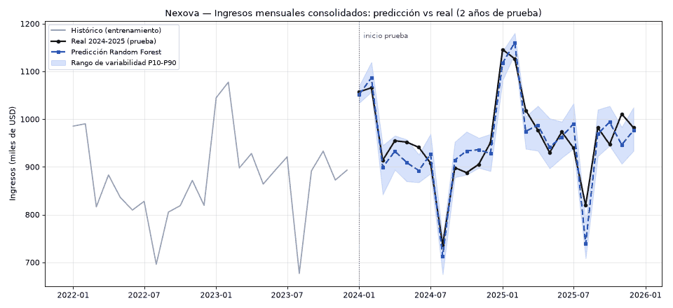

# Predicción de ventas de Nexova — modelo de regresión

Ticket: **Modelo de predicción de ventas** (RFI de Finanzas). Contexto: [`CONTEXT-nexova-sales.es.md`](./CONTEXT-nexova-sales.es.md).

## Cómo ejecutarlo

```bash
uv sync
uv run python scripts/sales_forecast.py   # entrena, evalúa y genera los archivos de esta carpeta
uv run pytest tests/pipelines -q          # prueba del split 8/2 años y de fuga de datos
```

| Archivo | Qué es |
|---|---|
| `data/raw/nexova_sales.csv` | Dataset provisto (120 meses `consolidated`, 2016-01 a 2025-12), sin modificar |
| `scripts/sales_forecast.py` | Carga, limpieza, split, features, entrenamiento, métricas y gráfico |
| `tests/pipelines/test_sales_forecast_split.py` | 5 pruebas: dataset vs CONTEXT, split 8/2, sin solape, sin fuga en features |
| `metrics.json` | Métricas sobre el conjunto de prueba |
| `forecast_test.csv` | Real vs predicción y banda P10–P90 mes a mes |
| `forecast_vs_real.png` | Visualización |

## Datos y split

- Se usa solo la fila `consolidated`; se validan las 5 columnas del CONTEXT.
- Nulos: se reindexa a todos los meses del rango y se interpola en el tiempo cualquier hueco o valor `revenue_usd <= 0`. El dataset provisto viene completo, así que no se altera ningún valor (ni la estacionalidad ni el crecimiento).
- **Entrenamiento: 2016-01 → 2023-12 (8 años, 96 meses). Prueba: 2024-01 → 2025-12 (2 años, 24 meses).** Split por año, sin barajar. El modelo no ve nada de 2024–2025.
- Escalado: `StandardScaler` dentro de un `Pipeline` (ajustado solo con train).
- Semilla fija: `random_state=42`.

## Features (todas causales)

Calendario (`month_sin`, `month_cos`, `is_august`, `is_jan_feb`) y, a partir del pasado: crecimiento interanual de hace 12 meses, crecimiento interanual del mes anterior, peso estacional del mes el año pasado (lag 12 / media móvil 12) y contratos y valor medio de contrato de hace 12 meses.

**Excluidas a propósito:** `active_contracts` y `avg_contract_value_usd` del mismo mes. En el dataset `revenue_usd = active_contracts × avg_contract_value_usd` (ratio ≈ 1,000), así que usarlas sería hacer trampa: no se conocen antes de cerrar el mes.

**Objetivo:** en lugar de predecir USD directamente, el modelo predice el **crecimiento interanual** (`ingreso / ingreso del mismo mes del año anterior`) y luego se reconstruye el importe. Motivo: los árboles no extrapolan, y como Nexova crece cada año, los ingresos de 2024–2025 están por encima de todo lo visto en entrenamiento.

## Por qué Random Forest (y no XGBoost)

1. **Pocos datos:** 96 meses de entrenamiento (72 utilizables tras calcular lags). XGBoost necesita ajuste fino para no sobreajustar; Random Forest es robusto con parámetros razonables.
2. **Explicabilidad para Finanzas:** "promediamos 500 árboles que han visto meses parecidos" se entiende en una reunión, y las importancias de variables son fáciles de leer.
3. **Rango de variabilidad incluido:** cada árbol da su predicción; los percentiles P10–P90 entre árboles forman la banda del gráfico.
4. **No es una suposición:** XGBoost se entrenó con el mismo protocolo como referencia y quedó ligeramente peor (ver tabla). No compensa su mayor complejidad.

## Evaluación honesta: predicción recursiva a 24 meses

La prueba simula la pregunta real de Finanzas ("¿cuánto venderemos los próximos 2 años?"): se predice mes a mes desde enero 2024 **sin usar ningún valor real de 2024–2025**. Cada predicción alimenta los lags del mes siguiente, así que en 2025 el modelo se apoya en sus propias predicciones de 2024 y el error se acumula. Es más exigente que predecir solo el mes siguiente.

## Resultados (conjunto de prueba 2024–2025)

| Métrica | Random Forest | XGBoost (referencia) | Base ingenua "igual que el año pasado" |
|---|---|---|---|
| **MSE** | 1.247.108.795 USD² | — | — |
| RMSE | 35.314 USD (**3,68 % del ingreso medio mensual**) | 3,94 % | 7,31 % |
| MAPE (error medio) | **3,15 %** | 3,36 % | 6,01 % |
| **K2 Score (R²)** | **0,833** | 0,809 | 0,341 |
| **Gini normalizado** | **0,876** | 0,874 | — |
| **PSI** predicción vs real (test) | 0,178 | — | — |
| **PSI** ingresos train vs test | 8,16 | — | — |
| Meses reales dentro de la banda P10–P90 | 18 de 24 (75 %) | — | — |

Ingreso medio mensual en el periodo de prueba: 959.363 USD.

**Frase para Finanzas:** *"De media, la predicción se desvía un 3 % del ingreso real del mes, con dos años de antelación. El mayor error fue en agosto de 2025 (−9,9 %): el modelo esperaba una caída de verano algo más fuerte de la que hubo."*

## Qué mide cada métrica

- **MSE (error cuadrático medio):** media de los errores al cuadrado, en USD². Penaliza mucho los errores grandes. Por sí solo no basta: está en unidades al cuadrado (difícil de explicar), depende de la escala del negocio, no dice si el modelo acierta *qué* meses son buenos o malos, y un MSE bajo en entrenamiento puede ser solo memorización. Por eso se reporta también como RMSE en % del ingreso medio y sobre el conjunto de prueba.
- **K2 Score:** el enunciado lo llama así; lo interpretamos como el **R² (coeficiente de determinación, `r2_score`)**, que es la métrica estándar de regresión con ese nombre. *Si el profesor se refiere a otra métrica, hay que ajustarlo.* Mide qué parte de la variación real entre meses explica el modelo (1 = toda, 0 = igual que predecir siempre la media). 0,83 → explica el 83 %.
- **Gini normalizado:** mide si el modelo **ordena** los meses de mejor a peor igual que la realidad (1 = orden perfecto, 0 = al azar). Es el KPI clave para Laura: distinguir un agosto "normalmente flojo" de una caída anómala. 0,88 es alto.
- **PSI (Population Stability Index):** compara dos distribuciones (<0,1 estable; 0,1–0,25 cambio moderado; >0,25 cambio fuerte).
  - *Predicción vs real en test (0,18):* las predicciones tienen una distribución parecida a la real; moderado, normal con solo 24 meses repartidos en 10 tramos.
  - *Ingresos train vs test (8,16):* cambio enorme y **esperado**: por el crecimiento anual, casi todos los meses de 2024–2025 superan los niveles típicos de 2016–2023. Justifica no modelar los USD directamente sino el crecimiento interanual.
  - *Mix de líneas de negocio:* el CONTEXT pide revisar si cambió el peso headhunting/outsourcing/formación, pero el dataset provisto solo tiene la fila `consolidated`, así que **no se puede calcular** con estos datos.

## Visualización



La línea azul es la predicción, la zona sombreada es el rango P10–P90 entre los 500 árboles y la línea negra son los ingresos reales de 2024–2025. Se ve que el modelo reproduce la subida de enero–febrero y la caída de agosto.

## Limitaciones

- La banda P10–P90 mide el desacuerdo entre árboles, no un intervalo de confianza estadístico formal; cubre el 75 % de los meses reales (lo ideal sería ~80 %), así que es algo estrecha.
- Con solo 10 años de historia, cualquier cambio de tendencia fuerte (crisis, nueva línea de negocio) no estaría en los datos.
- Contratos y valor medio futuros no se conocen: en la predicción recursiva se arrastran los del mismo mes del año anterior.
